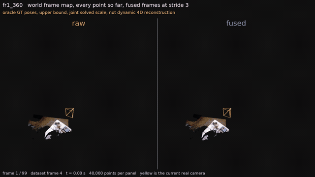
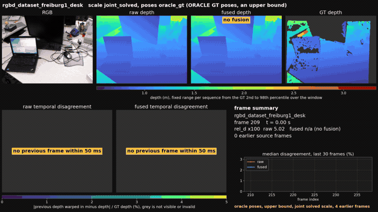

# PointDiT in Motion

**How reliable is a single-image 3D diffusion model when the camera moves, and how much of its error can training-free temporal fusion remove?**

Single-image point-map models are increasingly used on video, for robots, AR and mapping, but they are trained and benchmarked one image at a time. A model can score well per frame and still flicker, or carry the same wrong geometry from frame to frame. This project measures both on real handheld footage and asks what that implies for fixing the model's output with its own neighbouring frames.

PointDiT-L/16 (512 checkpoint, frozen DINOv3 ViT-L/16 encoder, 3 Euler steps, zero initialisation) is evaluated zero-shot on one 300-frame window from each of four TUM RGB-D sequences, 1,200 frames in total.


*Point maps of raw PointDiT, fused PointDiT and the Kinect ground truth on fr1_360. Fusion uses ground-truth motion-capture poses, so it is an upper bound.* [Flythrough video](https://github.com/Sainava/Pointdit-In-Motion/releases/tag/v1.0)



*The map grows as frames arrive, with raw PointDiT and fused PointDiT side by side. Frames are placed in the TUM world frame with ground-truth poses and a per-frame scale solved from the frame window. Only GT-valid pixels outside depth edges are drawn. This is an upper bound and not dynamic 4D reconstruction, so moving objects such as the person can ghost.*

## Headline results

| # | Result | Number | Source |
|---|---|---|---|
| 1 | Most per-frame error is shared between neighbouring frames | persistent fraction P 0.90 to 0.94 at 33 ms, 0.47 to 0.75 at 333 ms | `results/consistency_analysis/summary.md` |
| 2 | PointDiT is less self-consistent than the sensor's own ground truth under the same warp | M2 / M2 floor 1.34 to 1.92, robust in all 12 sequence and gap cells | `results/consistency_analysis/summary.md` |
| 3 | A forecast committed before any fusion run predicts short windows well and diverse windows badly | adjacent one-frame fusion within 0.7 percentage points of forecast, diverse four-frame fusion misses by up to 17.6 | `results/fusion_analysis/forecast_vs_measured.csv` |
| 4 | Fusing four earlier frames with window-solved scale lowers Rel_d by 4.3 % relative (0.25 Rel_d points), with ground-truth poses | pooled −4.3 % [−6.6, −2.1] on the 100 middle frames of each window, robust on 3 of 4 sequences | `results/fusion_analysis/deployable.csv` |
| 5 | Deterministic zero init is the right default for video | noise init adds 10 to 22 % short-term flicker and no accuracy | `results/sampling/summary.md` |
| 6 | Per-frame accuracy is 3.7 to 6.0 % Rel_d, driven by scene content and image sharpness | edge density ρ 0.62 pooled, partial sharpness ρ −0.26 | `results/analysis/summary.md` |
| 7 | On a T4, fp16 is 4.7 times faster than bf16 at negligible accuracy cost | 341 vs 1,593 ms per frame | `results/sweep/sweep_latency.csv` |

### 1. Persistence

On the same pixels, with each frame's GT as the common reference, the median per-frame error is 2.0 to 2.5 % while the disagreement between frames 33 ms apart is 0.44 to 0.82 %. P is the share of error variance the two frames have in common.

| Sequence | P at 33 ms | 100 ms | 333 ms |
|---|---|---|---|
| fr1_desk | 0.895 | 0.787 | 0.503 |
| fr1_room | 0.938 | 0.882 | 0.655 |
| fr1_360 | 0.918 | 0.837 | 0.470 |
| fr3_long_office | 0.931 | 0.897 | 0.750 |

Averaging nearby frames can therefore remove only the small view-dependent part of the error. Wider baselines decorrelate more error but bring in more warp and pose error. Shared GT noise slightly inflates P, and fr1 pose jitter lowers it at 333 ms, so those fr1 values are lower bounds.

### 2. Floor-controlled consistency

Frame-to-frame disagreement M2 is measured after fitting one frame's prediction to its neighbour's, and compared with the same measurement run on the Kinect GT itself (the M2 floor).

| Sequence | M2 at 33 ms | M2 / M2 floor at 33 / 100 / 333 ms |
|---|---|---|
| fr1_desk | 0.48 | 1.42 / 1.51 / 1.80 |
| fr1_room | 0.61 | 1.64 / 1.59 / 1.57 |
| fr1_360 | 0.56 | 1.50 / 1.77 / 1.92 |
| fr3_long_office | 0.34 | 1.34 / 1.50 / 1.70 |

- In absolute terms PointDiT is stable (0.3 to 0.6 % at 33 ms against 3.7 to 6.0 % per-frame error), but 1.3 to 1.9 times less consistent than its floor. The excess grows with gap on three of four sequences.
- At 33 ms, excess inconsistency follows scene content and the frame's own error (pooled fr1 ρ 0.32 edge density, 0.32 depth range, 0.39 Rel_d of the frame), not image sharpness.
- Relative to its floor, the nearest depth third is the least consistent in every sequence at 33 ms.
- Region-level flicker events are model behaviour. 98 of 99, 86 of 89, 45 of 50 and 22 of 25 events (fr1_360, fr1_room, fr1_desk, fr3) have no matching event in the GT floor. On fr3, 21 of 25 sit in the far third.
- The GT floor must use depth-timestamp poses on fr1. RGB-timestamp poses raise it by 19 to 30 % on fr1_desk.

### 3. Pre-registered forecast against measurement

Before any fusion result existed, the measured P and GT floors were turned into a forecast of the Rel_d change for 12 fusion windows per sequence (`report/fusion_forecast.md`, commit `0bde887`). Fusion was then run with oracle scale (each frame aligned to its own GT), which is the setting the forecast assumes.

| Sequence | Causal 1 frame, forecast / measured % | Causal diverse 4 frames, forecast / measured % |
|---|---|---|
| fr1_desk | −2.2 / −1.8 | −12.9 / +4.7 |
| fr1_room | −1.4 / −2.1 | −8.5 / −7.0 |
| fr1_360 | −1.7 / −2.4 | −12.1 / +3.9 |
| fr3_long_office | −1.6 / −1.9 | −6.8 / −3.4 |

Short adjacent windows behave as forecast. The forecast's key assumption, that temporal diversity pays off, fails on fr1_desk and fr1_360, which have the fastest motion and largest warp error. A GT-only control (fusing GT depth instead of predictions) still lowers error by 52 to 87 %, so the warp itself is not the bottleneck.

### 4. Deployable fusion (upper bound)

Configuration. Four previous frames, per-pixel median, each frame's scale and shift solved jointly from parallax within the window, ground-truth poses, scored on the 100 frames at window positions 100 to 199 of each sequence. As for the raw baseline, the fused depth is affine-aligned to the target GT before scoring.

| Sequence | Mean change % [95 % CI] | Robust | Rel_d points | Frames improved |
|---|---|---|---|---|
| fr1_desk | −2.4 [−7.7, 4.2] | no | −0.13 | 64 % |
| fr1_room | −4.5 [−7.9, −1.5] | yes | −0.26 | 74 % |
| fr1_360 | −5.9 [−11.6, −1.0] | yes | −0.40 | 76 % |
| fr3_long_office | −4.3 [−8.7, −1.6] | yes | −0.22 | 71 % |
| Pooled | −4.3 [−6.6, −2.1] | yes | −0.25 | 71 % |

| Control | Result | Source |
|---|---|---|
| Shuffled poses | 58 to 212 % worse (oracle and joint) | `results/fusion_analysis/controls.csv` |
| No-fusion identity | equals baseline within 1.5e-6 | `results/fusion_analysis/nofusion.csv` |
| Pipeline regression | baseline reproduced on 400 frames within 1.1e-6 | `results/fusion/*/baseline/regression_status.json` |
| Pose noise (oracle diverse config only) | fr3 worse by 6.9 % at 10 mm and 11.2 % at 0.5° relative to noise-free | `results/fusion_analysis/controls.csv` |

Over the full 300-frame windows, run on fr1_360 and fr1_desk only, fusion lowers Rel_d on 74.0 % and 59.5 % of frames, but the mean change is −4.05 % [−7.57, +0.21] and −2.23 % [−4.86, +0.09], so it is not robust. Per-frame changes range from −21 to +12 % (10th to 90th percentile) on fr1_360. The fused point maps look almost identical to the raw ones by eye.

### 5. Zero init versus noise init

On two 100-frame subsets (fr1_360 200 to 299, fr3 740 to 839), starting the sampler from seeded noise instead of zeros raises M2 at 33 ms by 10 to 22 % on fr1_360 and 14 to 18 % on fr3 (all six seed and sequence CIs exclude no change). Rel_d changes by only +0.01 to +0.03 points. Two noise seeds disagree on the same frame by 0.27 to 0.33 %. The effect is smaller at 100 ms (4 to 10 %, robust for two of three fr3 seeds) and largely absent at 333 ms.

### 6. Per-frame accuracy and what drives it

| Sequence | Window | Rel_d mean / median | δ1_d mean |
|---|---|---|---|
| fr1_desk | 209–508 | 4.24 / 3.91 | 97.63 |
| fr1_room | 366–665 | 5.99 / 6.06 | 94.80 |
| fr1_360 | 0–299 | 5.09 / 5.02 | 96.59 |
| fr3_long_office | 637–936 | 3.66 / 3.79 | 98.22 |

- Scene content is the strongest factor. Rel_d rises with depth-edge density (pooled fr1 ρ 0.62, fr1_360 0.86) and depth range (pooled 0.54).
- Lower relative sharpness predicts higher error independently of GT timing and edge density (partial ρ −0.23 to −0.29 in every sequence, pooled −0.26 [−0.36, −0.18]). It holds on fr3, where depth and RGB are synchronised.
- Camera speed is a weak predictor, clear only on fr1_360 (ρ 0.34). It may act through blur, but that was not tested directly.
- The worst fr1_room and fr1_desk frames fail in whole regions placed at the wrong depth (59 to 66 % of the excess outside the edge band), not at edges.

### 7. Compute sweep on a Kaggle T4

200 frames (the two sampling subsets), single process. The GPU clock fell from 1,590 to 585 MHz during the first configuration and stayed there, so latencies are relative. Accuracy is the median per-frame Rel_d difference against the bf16 baseline with a block-15 bootstrap interval.

| Config | Latency ms | Rel_d diff [95 % CI] | Peak GB |
|---|---|---|---|
| bf16, 3 steps (baseline) | 1593 | 0 | 3.99 |
| fp16 | 341 | +0.007 [0.004, 0.015] | 3.85 |
| 1 step | 797 | +0.107 [0.081, 0.123] | 3.97 |
| 2 steps | 1201 | +0.020 [0.003, 0.036] | 3.99 |
| 4 steps | 2008 | +0.004 [−0.006, 0.016] | 3.99 |
| 512 tokens | 744 | +0.254 [0.144, 0.437] | 3.84 |
| 2048 tokens | 3715 | +0.216 [0.092, 0.286] | 4.46 |
| PointDiT-B/16 | 495 | +0.796 [0.520, 1.007] | 1.27 |
| Input downscale 2 | 1601 | −0.017 [−0.056, 0.014] | 3.99 |

The T4 has no native bf16 support, which likely explains the fp16 speed-up. Extra steps and other token budgets do not help, and PointDiT-B/16 is clearly less accurate.



*Diagnostic view on fr1_desk. RGB, raw depth, fused depth, ground-truth depth and frame-to-frame disagreement maps.*

## How we measure

| Term | Definition |
|---|---|
| GT | Kinect depth of the frame (16-bit PNG / 5000, zero is invalid), back-projected with the TUM intrinsics. Poses are motion-capture ground truth interpolated to each timestamp |
| Alignment | PointDiT's output is defined only up to scale and shift. Upstream's exact weighted-L1 fit of one scale and one shift to GT depth, solved on a 64×64 subsample and applied to the whole frame |
| Rel_d | Mean of abs(aligned depth − GT) / GT over GT-valid pixels, ×100 |
| Warp | Back-project frame i's depth, move it into camera j with the relative GT pose, project, and keep the nearest point per pixel |
| Visible pixels | Pixels of frame j hit by frame i's warped GT whose depth agrees with GT_j within 15 % (same surface, not occluded) |
| Interior pixels | Visible pixels more than 5 px from a GT depth edge or hole |
| GT floor | Disagreement of GT with itself under the same warp (Kinect noise, pose error, warping error) |
| M1 | Disagreement between frames i and j when each prediction is aligned to its own GT |
| M2 | Disagreement after fitting frame j's raw prediction to frame i's warped aligned prediction. Pure self-consistency |
| M2 floor | M2 computed with GT in place of predictions, the M2 a perfect predictor would get |
| M2 / M2 floor | Median over pairs of the per-pair ratio. 1 means as consistent as the sensor |
| Persistent fraction P | 1 − Var(E_i − E_j) / (Var E_i + Var E_j), with E the signed relative error of each frame against GT_j on the same pixels. 1 means identical errors, 0 unrelated |

Values are per-pair medians over visible pixels, then the median over pairs. Pairs are matched by time (33, 100 and 333 ms, within 10 ms). Intervals are 95 % moving-block bootstrap intervals with 2,000 resamples, and a result is called robust only if the interval excludes the reference value at block lengths 8, 15 and 30. Sampling and the compute sweep use block 15 only. The metric code is upstream's and reproduces its numbers exactly on 10 Booster scenes. Full formulas are in `report/project_guide.md` §4.

## Negative and refuted results

| Hypothesis | Outcome | Source |
|---|---|---|
| Temporally diverse fusion windows beat adjacent ones (forecast) | Refuted on fr1_desk and fr1_360 | `results/fusion_analysis/forecast_vs_measured.csv` |
| Masking depth edges or falling back to the target at edges improves fusion | Refuted, every edge variant worse than the plain median on all four sequences | `report/fusion_oracle_readout.md` |
| A front-layer rule helps fusion | Inconsistent, fr1_desk 9.0 % worse (robust) | `results/fusion_analysis/summary.md` |
| Fusion helps over full windows | Mean not robust on fr1_360 or fr1_desk | `results/fusion_frame_share/summary.md` |
| A wrong implied focal length explains error | Inconclusive and dropped, only 121 of 1,200 frames pass a split-half check | `results/analysis/summary.md` |
| A wide depth range explains why fr1_room is harder than fr1_360 | Refuted, its worst frame has a narrow range (0.62 to 2.91 m) | `report/analysis_compute.md` |
| Camera speed drives error | Weak, clear only on fr1_360 | `results/analysis/summary.md` |
| Near objects cut by the border are a general failure mode | Inconclusive, pooled ρ 0.26 not robust | `results/analysis/summary.md` |
| Blur drives inconsistency | No, pooled partial ρ −0.08 not robust | `results/consistency_analysis/summary.md` |
| Noise init improves accuracy | No, +0.01 to +0.03 Rel_d points | `results/sampling/summary.md` |
| More sampling steps or tokens improve accuracy | No | `results/sweep/sweep_accuracy.csv` |

## Limitations

- One 300-frame window per sequence, and neighbouring frames and pairs are strongly autocorrelated. All driver results are correlational.
- All fusion results use ground-truth motion-capture poses and are an upper bound for a system with estimated poses. Pose noise was tested only on an oracle-scale configuration.
- Fusion is scored on 100 frames per sequence. The joint solver recovers depth to about 8 to 13 % on fr1_desk, fr1_room and fr3 but only about 400 % on fr1_360, where 66 of 100 windows are rotation dominated. Final per-frame alignment to GT absorbs most of this scale error.
- Sampling and the compute sweep cover two 100-frame subsets. Sweep latencies come from a throttled clock.
- fr1 uses approximate intrinsics, has depth lagging RGB by up to about 20 ms, and has motion-capture jitter that inflates speeds and lowers P at 333 ms. Use Rel_d, not Rel_p, to compare fr1 with fr3.
- Kinect GT has holes, edge shadows and noise growing with distance. Edge density includes hole boundaries.
- Full 640×480 frames at the default token budget (448×592) and a different protocol from the paper's 512 crop, so numbers are not comparable with the paper's tables.
- Flicker and spike rules are threshold choices.

## Reports and layout

| Report | Content |
|---|---|
| `report/data_metrics.md` | Pipeline, validation, baseline accuracy, failure clusters |
| `report/analysis_compute.md` | Error maps, covariates, drivers of per-frame error, compute sweep |
| `report/temporal_consistency.md` | Consistency, sampling noise, drivers, flicker, persistence |
| `report/fusion_forecast.md` | Pre-registered fusion forecast |
| `report/fusion_oracle_readout.md` | Oracle and joint fusion, bootstrap analysis, full-window share |
| `report/notes.md` | Protocol details and caveats |
| `report/project_guide.md` | Walkthrough of the pipeline and formulas for phases 1 to 3 |

| Path | Content |
|---|---|
| `src/pim/` | Data loading, metrics, consistency, fusion, rendering |
| `scripts/` | Command-line entry points |
| `notebooks/` | Kaggle runner (GPU) and evaluation (CPU) notebooks |
| `configs/` | Sequence windows, run and sweep configurations |
| `results/` | Result tables and summaries per phase. `results/sweep/runs/` holds the sweep run records |
| `report/` | Write-ups and figures |
| `third_party/pointdit` | Fork of PointDiT (Sainava/Sai-pointdit), submodule pinned at `664736a` |

## Reproducing

Python version is unspecified (no version is pinned in `requirements.txt`, `requirements-dev.txt` or a pyproject). Runs used torch 2.11.0 with CUDA 12.8 on Kaggle.

```bash
git clone --recurse-submodules https://github.com/Sainava/Pointdit-In-Motion.git
cd Pointdit-In-Motion
python -m venv .venv && .venv/bin/pip install -r requirements-dev.txt
.venv/bin/pytest -q tests/test_fusion.py tests/test_stats.py
```

Inference needs a GPU and the PointDiT and DINOv3 weights, which are not included. Full runs were done on Kaggle with the notebooks in `notebooks/`. Evaluation memory is high (about 3.5 GB peak per frame in the alignment), so run full sweeps on a machine with at least 16 GB of RAM. Video rendering uses ffmpeg when it is on the PATH and writes PNG frames otherwise.

## Licence, data and citation

Code in this repository is MIT licensed. PointDiT, DINOv3 and the TUM RGB-D dataset keep their own licences. The dataset and model weights are not redistributed here. To cite this work, use `CITATION.cff`.

## Acknowledgements

PointDiT (ICML 2026) by its authors, the TUM RGB-D benchmark, and DINOv3 from Meta AI.
