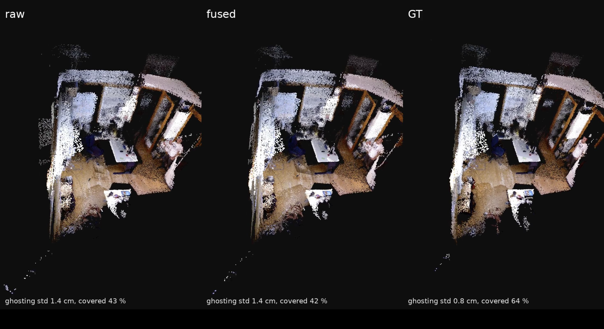

# PointDiT in Motion

How reliable is a single-image 3D diffusion model for a camera moving through a room, and how much of its error can training-free temporal fusion remove?

This project evaluates PointDiT, a point-map diffusion transformer trained on synthetic data, zero-shot on four real TUM RGB-D indoor sequences (300 frames each, 1,200 frames in total).



*Point maps of raw PointDiT, fused PointDiT and the Kinect ground truth. Fusion uses ground-truth camera poses, so it is an upper bound.* [Flythrough video](RELEASE_LINK)

## Main results

| Question | Result |
|---|---|
| Per-frame accuracy | 3.7 to 6.0 % mean relative depth error after per-frame affine alignment (fr3 3.66, fr1_desk 4.24, fr1_360 5.09, fr1_room 5.99) |
| What drives error | Scene content (depth edges, depth range) and image sharpness. Camera speed matters only through blur |
| Temporal consistency | Predictions are 1.3 to 1.9 times less consistent than the ground-truth sensor data under the same warping procedure |
| Persistence | 90 to 94 % of error variance is shared between frames 33 ms apart, falling to 47 to 75 % at 333 ms |
| Sampler start | Random noise initialisation adds 10 to 22 % more short-term flicker than the default zero start, with no accuracy gain |
| Temporal fusion | Fusing four earlier frames with window-estimated scale lowers mean relative depth error by about 4 % pooled (robust on three of four sequences), using ground-truth poses |
| Inference speed on a T4 | fp16 is 4.7 times faster than bf16 with negligible accuracy loss. The ViT-B variant is clearly less accurate |


*Diagnostic view. RGB, raw depth, fused depth, ground truth depth and frame-to-frame disagreement maps.*

## Method in brief

1. A TUM RGB-D loader pairs RGB and depth by timestamp and interpolates ground-truth poses. Metrics reuse the paper's alignment and evaluation code and match it exactly on 10 Booster scenes.
2. Predictions are cached, then evaluated against ground truth with per-frame affine alignment.
3. Consistency is measured by warping one frame's prediction into another with the true camera motion, compared against a floor computed from the ground truth itself.
4. Fusion warps earlier predictions into the target view and takes a median. A forecast derived from the persistence measurement was committed before any fusion result existed (`report/fusion_forecast.md`).
5. Controls include shuffled poses, pose noise, a no-fusion identity check and regression checks against earlier runs.

## Limitations

- One 300-frame window per sequence, and neighbouring frames are highly correlated. Results are correlational.
- All fusion results use ground-truth motion-capture poses, so they are an upper bound for a system with estimated poses. Pose noise of about 10 mm or 0.5 degrees removes the gain on fr3.
- Fusion helps on most frames and hurts on some. Over full windows the mean change is small and its interval includes zero. See `results/fusion_frame_share/`.
- Full 640 by 480 frames and a different protocol, so numbers are not comparable with the paper's tables.
- Sweep latencies were measured under a throttled GPU clock and are relative to each other.
- The fused point maps look almost identical to the raw ones by eye. The gains show up in statistics, not in still renders.

## Repository layout

| Path | Content |
|---|---|
| `src/pim/` | Data loading, metrics, consistency, fusion, rendering |
| `scripts/` | Command-line entry points |
| `notebooks/` | Kaggle runner (GPU) and evaluation (CPU) notebooks |
| `configs/` | Sequence windows, run and sweep configurations |
| `results/` | Result tables and summaries |
| `report/` | Write-ups, figures and `project_guide.md`, a full walkthrough of the pipeline and formulas |
| `third_party/pointdit` | Fork of PointDiT, pinned submodule |

## Reproducing

```bash
git clone --recurse-submodules https://github.com/Sainava/Pointdit-In-Motion.git
cd Pointdit-In-Motion
python -m venv .venv && .venv/bin/pip install -r requirements-dev.txt
.venv/bin/pytest -q tests/test_fusion.py tests/test_stats.py
```

Inference needs a GPU and the PointDiT and DINOv3 weights, which are not included. Full runs were done on Kaggle with the notebooks in `notebooks/`. Evaluation memory is high (several GB per frame), so run full sweeps on a machine with at least 16 GB of RAM.

## Licences and data

Code in this repository is MIT licensed. PointDiT, DINOv3 and the TUM RGB-D dataset keep their own licences. The dataset and model weights are not redistributed here.

## Acknowledgements

PointDiT (ICML 2026) by its authors, the TUM RGB-D benchmark, and DINOv3 from Meta AI.