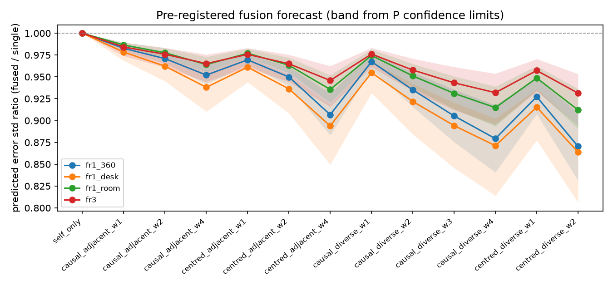

# Temporal fusion forecast (pre-registered)

**Status.** This file is committed before any fusion result exists. It must not be edited afterwards, except to add a clearly marked errata section at the end. Fusion results are compared against these numbers as written here.

Script `scripts/fusion_forecast.py`, output `results/forecast/fusion_forecast.csv`, figure `report/figures/forecast/forecast.png`, tests `tests/test_fusion_forecast.py`. The forecast uses only the measured persistence and GT floors. No prediction or depth file was read.

## Model

Each source k is a frame at time offset t_k from the target (t = 0 is the target itself). Its error seen in the target view is modelled as shared model error plus independent warp noise. Fusion takes the equal-weight mean of N sources. The predicted ratio of fused to single-frame error std is

```
ratio = sqrt( (1 / N^2) * ( sum_{k,l} rho(|t_k - t_l|) + sum_{k : t_k != 0} (s(|t_k|) / sigma(|t_k|))^2 ) )
```

The first sum runs over all ordered pairs, including k = l where rho(0) = 1. A ratio below 1 means fusion reduces the error spread.

- **rho(g)** is the persistent fraction P at gap g. Between 33, 100 and 333 ms it is linear in log(g). Below 33 ms it is linear in g from rho(0) = 1 to P(33). Beyond 333 ms it is held at P(333).
- **s(g)** is the visible-pixel GT floor median (`gt_floor_depth_median`), interpolated the same way with s(0) = 0.
- **sigma(g)** is the visible-pixel median |E_j| at the same gap, interpolated the same way and held flat below 33 ms. s and sigma are both medians of absolute values in percent, so the Gaussian median-to-std factor cancels.
- **Rel_d change** is 100 * (ratio − 1). A negative value means the mean Rel_d is predicted to fall.
- **Low and high** use the lower and upper P confidence limits at all three anchors together. The ratio increases with rho, so the lower P limits give the lower ratio. Each limit is the widest across block lengths 8, 15 and 30 (the smallest ci_low and the largest ci_high). s and sigma are fixed at their point values.

Inputs (visible pixels) are below. Values are in percent, except P.

| Sequence | P 33 / 100 / 333 | P CI low | P CI high | median abs E_j 33 / 100 / 333 | GT floor 33 / 100 / 333 |
|---|---|---|---|---|---|
| fr1_360 | 0.918 / 0.837 / 0.470 | 0.906 / 0.804 / 0.328 | 0.932 / 0.874 / 0.615 | 2.44 / 2.38 / 2.27 | 0.397 / 0.627 / 1.336 |
| fr1_desk | 0.895 / 0.787 / 0.503 | 0.857 / 0.699 / 0.344 | 0.923 / 0.836 / 0.596 | 1.98 / 1.90 / 1.77 | 0.388 / 0.514 / 0.964 |
| fr1_room | 0.938 / 0.882 / 0.655 | 0.928 / 0.851 / 0.587 | 0.950 / 0.910 / 0.746 | 2.52 / 2.46 / 2.23 | 0.322 / 0.457 / 0.781 |
| fr3 | 0.931 / 0.897 / 0.750 | 0.891 / 0.840 / 0.636 | 0.951 / 0.926 / 0.830 | 2.33 / 2.30 / 2.24 | 0.261 / 0.296 / 0.407 |

## Assumptions

1. **Equal error variance across frames.** Every source has the same single-frame error std as the target. P = 1 − Var(E_i − E_j) / (Var(E_i) + Var(E_j)) equals the Pearson correlation only under this assumption.
2. **P used as correlation.** rho between two sources is the P measured between a frame pair at that gap. Correlation is assumed to depend only on the time gap, not on the content of the frames or on which frame is the target.
3. **Alignment and scale error ignored.** The first fusion runs use oracle (GT-aligned) scale, which matches how E_i and E_j were measured. The forecast does not cover estimated scale.
4. **Pose noise ignored.** Source warps are assumed exact apart from the warp noise term. Pose jitter on fr1 lowers P at 333 ms. This makes the diverse forecasts on fr1 optimistic if fusion uses the same poses, and conservative if it uses better poses.
5. **Extrapolation beyond 333 ms.** rho, s and sigma are held at their 333 ms values for the 400 ms offset and for source pairs up to 400 ms apart. If P keeps falling beyond 333 ms this makes causal_diverse_w3, causal_diverse_w4 and centred_diverse_w2 pessimistic.
6. **Rel_d scales with the std ratio.** The error distribution shape is assumed fixed under fusion, so mean |error| and mean Rel_d scale by the same factor as the std.
7. **Interpolation.** rho, s and sigma are linear in log(g) between the measured gaps, and rho and s are linear in g below 33 ms. All source offsets are multiples of 33 or 100 ms, so only the pairwise gaps 33, 66, 99, 132, 165, 198, 231, 264, 100, 200, 300 and 400 ms are used.
8. **Warp noise may be counted twice.** E_i in the persistence analysis is already frame i warped into frame j, so the measured P already contains some warp and GT noise decorrelation. The extra warp noise term then makes the main forecast conservative. The column `pred_std_ratio_no_extra_warp` drops that term and serves as the optimistic end of this assumption. The two differ by about 0.02 at most.
9. **Shared GT noise.** GT_j is the common reference for E_i and E_j, which slightly inflates P. This makes the forecast conservative.
10. **Uncertainty band.** The band covers only the P confidence limits. It ignores uncertainty in s and sigma and the structural assumptions above.
11. **Visible pixels.** All inputs use the visible region. The forecast applies to target pixels that are visible in all sources, which is a subset of the pixels fusion will score.

A property of the formula that affects interpretation. The target carries no warp noise, so adding one noisy source helps only when (s / sigma)^2 < 1 − rho at that offset. This holds at every gap and sequence here (the largest ratio of the two is 0.65, on fr1_360 at 333 ms), so every configuration is predicted to help.

## Forecast

Std ratio is fused over single-frame error std, with the band from the P confidence limits. Rel_d change is in percent, with the matching band. Self only gives a ratio of 1 and a change of 0 for every sequence.



### fr1_360

| Config | N | Offsets (ms) | Std ratio [low, high] | Rel_d change % [low, high] | Std ratio, no extra warp |
|---|---|---|---|---|---|
| causal_adjacent_w1 | 2 | 0 -33 | 0.983 [0.980, 0.986] | -1.7 [-2.0, -1.4] | 0.979 |
| causal_adjacent_w2 | 3 | 0 -33 -66 | 0.971 [0.965, 0.977] | -2.9 [-3.5, -2.3] | 0.967 |
| causal_adjacent_w4 | 5 | 0 -33 -66 -99 -132 | 0.952 [0.942, 0.964] | -4.8 [-5.8, -3.6] | 0.947 |
| centred_adjacent_w1 | 3 | 0 -33 33 | 0.970 [0.964, 0.976] | -3.0 [-3.6, -2.4] | 0.967 |
| centred_adjacent_w2 | 5 | 0 -33 33 -66 66 | 0.950 [0.940, 0.962] | -5.0 [-6.0, -3.8] | 0.947 |
| centred_adjacent_w4 | 9 | 0 -33 33 -66 66 -99 99 -132 132 | 0.907 [0.883, 0.931] | -9.3 [-11.7, -6.9] | 0.903 |
| causal_diverse_w1 | 2 | 0 -100 | 0.967 [0.959, 0.977] | -3.3 [-4.1, -2.3] | 0.958 |
| causal_diverse_w2 | 3 | 0 -100 -200 | 0.935 [0.915, 0.956] | -6.5 [-8.4, -4.5] | 0.919 |
| causal_diverse_w3 | 4 | 0 -100 -200 -300 | 0.905 [0.875, 0.935] | -9.5 [-12.5, -6.5] | 0.885 |
| causal_diverse_w4 | 5 | 0 -100 -200 -300 -400 | 0.879 [0.841, 0.918] | -12.1 [-15.9, -8.2] | 0.858 |
| centred_diverse_w1 | 3 | 0 -100 100 | 0.927 [0.907, 0.948] | -7.3 [-9.2, -5.2] | 0.919 |
| centred_diverse_w2 | 5 | 0 -100 100 -200 200 | 0.870 [0.831, 0.909] | -13.0 [-16.9, -9.1] | 0.858 |

### fr1_desk

| Config | N | Offsets (ms) | Std ratio [low, high] | Rel_d change % [low, high] | Std ratio, no extra warp |
|---|---|---|---|---|---|
| causal_adjacent_w1 | 2 | 0 -33 | 0.978 [0.969, 0.986] | -2.2 [-3.1, -1.4] | 0.974 |
| causal_adjacent_w2 | 3 | 0 -33 -66 | 0.962 [0.945, 0.973] | -3.8 [-5.5, -2.7] | 0.957 |
| causal_adjacent_w4 | 5 | 0 -33 -66 -99 -132 | 0.938 [0.910, 0.955] | -6.2 [-9.0, -4.5] | 0.932 |
| centred_adjacent_w1 | 3 | 0 -33 33 | 0.961 [0.944, 0.972] | -3.9 [-5.6, -2.8] | 0.957 |
| centred_adjacent_w2 | 5 | 0 -33 33 -66 66 | 0.936 [0.908, 0.953] | -6.4 [-9.2, -4.7] | 0.932 |
| centred_adjacent_w4 | 9 | 0 -33 33 -66 66 -99 99 -132 132 | 0.894 [0.850, 0.919] | -10.6 [-15.0, -8.1] | 0.890 |
| causal_diverse_w1 | 2 | 0 -100 | 0.955 [0.931, 0.968] | -4.5 [-6.9, -3.2] | 0.945 |
| causal_diverse_w2 | 3 | 0 -100 -200 | 0.922 [0.884, 0.942] | -7.8 [-11.6, -5.8] | 0.906 |
| causal_diverse_w3 | 4 | 0 -100 -200 -300 | 0.894 [0.846, 0.921] | -10.6 [-15.4, -7.9] | 0.876 |
| causal_diverse_w4 | 5 | 0 -100 -200 -300 -400 | 0.871 [0.814, 0.902] | -12.9 [-18.6, -9.8] | 0.852 |
| centred_diverse_w1 | 3 | 0 -100 100 | 0.915 [0.877, 0.936] | -8.5 [-12.3, -6.4] | 0.906 |
| centred_diverse_w2 | 5 | 0 -100 100 -200 200 | 0.864 [0.806, 0.895] | -13.6 [-19.4, -10.5] | 0.852 |

### fr1_room

| Config | N | Offsets (ms) | Std ratio [low, high] | Rel_d change % [low, high] | Std ratio, no extra warp |
|---|---|---|---|---|---|
| causal_adjacent_w1 | 2 | 0 -33 | 0.987 [0.984, 0.990] | -1.4 [-1.6, -1.0] | 0.984 |
| causal_adjacent_w2 | 3 | 0 -33 -66 | 0.978 [0.973, 0.983] | -2.2 [-2.7, -1.7] | 0.975 |
| causal_adjacent_w4 | 5 | 0 -33 -66 -99 -132 | 0.964 [0.955, 0.973] | -3.6 [-4.5, -2.7] | 0.962 |
| centred_adjacent_w1 | 3 | 0 -33 33 | 0.977 [0.972, 0.982] | -2.3 [-2.8, -1.8] | 0.975 |
| centred_adjacent_w2 | 5 | 0 -33 33 -66 66 | 0.963 [0.955, 0.972] | -3.7 [-4.5, -2.8] | 0.962 |
| centred_adjacent_w4 | 9 | 0 -33 33 -66 66 -99 99 -132 132 | 0.936 [0.920, 0.952] | -6.4 [-8.0, -4.8] | 0.934 |
| causal_diverse_w1 | 2 | 0 -100 | 0.975 [0.967, 0.982] | -2.5 [-3.4, -1.8] | 0.970 |
| causal_diverse_w2 | 3 | 0 -100 -200 | 0.951 [0.938, 0.965] | -4.9 [-6.2, -3.5] | 0.945 |
| causal_diverse_w3 | 4 | 0 -100 -200 -300 | 0.931 [0.913, 0.951] | -6.9 [-8.7, -4.9] | 0.924 |
| causal_diverse_w4 | 5 | 0 -100 -200 -300 -400 | 0.915 [0.893, 0.939] | -8.5 [-10.7, -6.1] | 0.907 |
| centred_diverse_w1 | 3 | 0 -100 100 | 0.949 [0.935, 0.963] | -5.1 [-6.5, -3.8] | 0.945 |
| centred_diverse_w2 | 5 | 0 -100 100 -200 200 | 0.912 [0.891, 0.936] | -8.8 [-10.9, -6.4] | 0.907 |

### fr3

| Config | N | Offsets (ms) | Std ratio [low, high] | Rel_d change % [low, high] | Std ratio, no extra warp |
|---|---|---|---|---|---|
| causal_adjacent_w1 | 2 | 0 -33 | 0.984 [0.974, 0.989] | -1.6 [-2.6, -1.1] | 0.983 |
| causal_adjacent_w2 | 3 | 0 -33 -66 | 0.976 [0.961, 0.983] | -2.4 [-3.9, -1.7] | 0.974 |
| causal_adjacent_w4 | 5 | 0 -33 -66 -99 -132 | 0.965 [0.944, 0.976] | -3.5 [-5.6, -2.4] | 0.964 |
| centred_adjacent_w1 | 3 | 0 -33 33 | 0.976 [0.961, 0.983] | -2.4 [-3.9, -1.7] | 0.974 |
| centred_adjacent_w2 | 5 | 0 -33 33 -66 66 | 0.965 [0.944, 0.975] | -3.5 [-5.6, -2.5] | 0.964 |
| centred_adjacent_w4 | 9 | 0 -33 33 -66 66 -99 99 -132 132 | 0.946 [0.916, 0.962] | -5.4 [-8.4, -3.8] | 0.945 |
| causal_diverse_w1 | 2 | 0 -100 | 0.976 [0.961, 0.983] | -2.4 [-3.9, -1.7] | 0.974 |
| causal_diverse_w2 | 3 | 0 -100 -200 | 0.958 [0.934, 0.971] | -4.2 [-6.6, -2.9] | 0.955 |
| causal_diverse_w3 | 4 | 0 -100 -200 -300 | 0.943 [0.912, 0.961] | -5.7 [-8.8, -3.9] | 0.941 |
| causal_diverse_w4 | 5 | 0 -100 -200 -300 -400 | 0.932 [0.895, 0.954] | -6.8 [-10.4, -4.6] | 0.930 |
| centred_diverse_w1 | 3 | 0 -100 100 | 0.957 [0.933, 0.971] | -4.3 [-6.7, -3.0] | 0.955 |
| centred_diverse_w2 | 5 | 0 -100 100 -200 200 | 0.931 [0.895, 0.953] | -6.9 [-10.5, -4.7] | 0.930 |

## Expectations

**Across sequences.** Fusion is predicted to help everywhere, but modestly. Most per-frame error is shared between nearby frames, so averaging removes only the small view-dependent part. Diversity matters more than count. At N = 5, the diverse windows beat the adjacent ones on every sequence, by about 3 to 7 points of Rel_d. At equal N and equal pairwise gaps, centred and causal windows are almost the same. Any difference comes only from the warp noise of the more distant sources. No configuration is predicted to cut Rel_d by more than about 14% (19% at the edge of the band).

**fr1_360.** Errors decorrelate fastest here at long gaps (P drops to 0.47 at 333 ms), so diverse windows pay off most. Adjacent fusion with one previous frame should give about a 2% Rel_d reduction. The best configurations (centred_diverse_w2, causal_diverse_w4) should give about 12 to 13%, with a band of roughly 8 to 17%. Pose jitter on this sequence lowers the measured P at 333 ms, so if fusion is hurt by the same jitter, the diverse gains may come out at the weak end of the band.

**fr1_desk.** This sequence has the largest predicted gains and the widest bands, because P falls steeply with gap and its confidence intervals are wide. Expect about 2% from one adjacent frame, 6% from four, and about 13 to 14% from the best diverse windows (band about 10 to 19%). It is the sequence most likely to show a clear benefit from temporal diversity.

**fr1_room.** Errors stay correlated longer here (P 0.66 at 333 ms) and the error level is high relative to the GT floor, so gains are moderate. Expect about 1.4% from one adjacent frame, 3.5% from four, and about 8.5 to 9% from the best diverse windows (band about 6 to 11%).

**fr3.** This sequence has the most persistent errors (P 0.75 even at 333 ms) and the smallest predicted gains. Expect about 1.6% from one adjacent frame, 3.5% from four adjacent frames, and about 7% at best from the diverse windows (band about 5 to 10%). Its low GT floor means warp noise costs almost nothing, so its forecast depends almost entirely on P. A result well below this band would suggest that the model is wrong for this sequence, not that warp noise is the cause.

**How to read a fusion result against this.** A measured Rel_d change inside the band supports the persistence model. A smaller gain points to warp, pose or scale effects that the model ignores. A larger gain than the no-extra-warp ratio implies would mean fusion does something beyond averaging, such as rejecting outlier sources, that the model does not capture.
